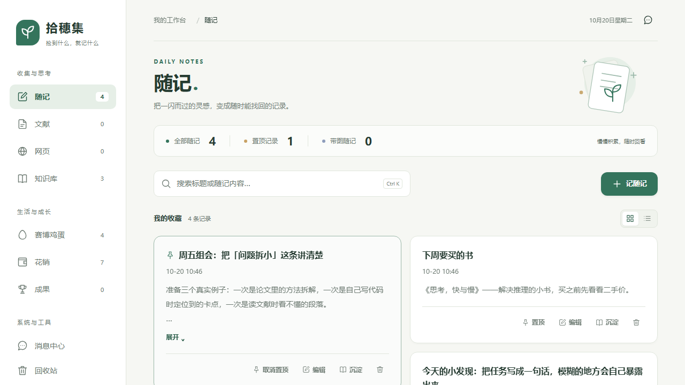
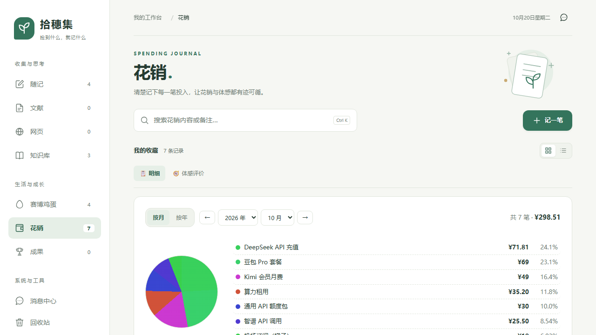
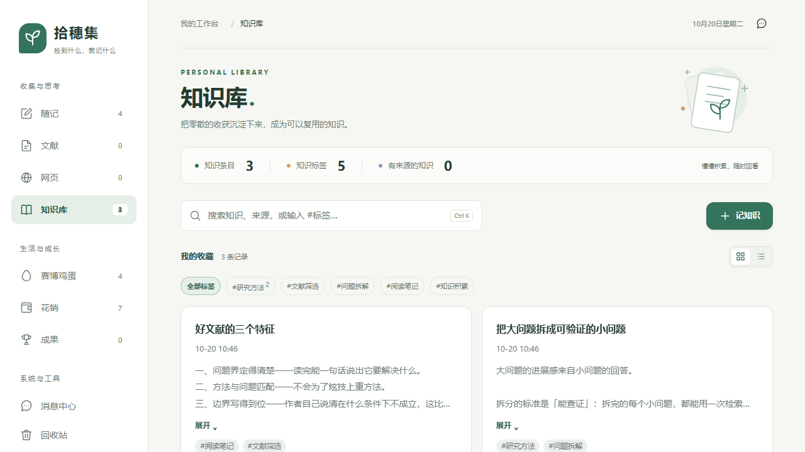

# 🧺 拾穗集

捡到什么就记什么。一个在自己电脑上保存数据、可与 Android 手机同步的个人工作台。

- **随记**：文字、图片、置顶；手机可离线记录，联网后同步。
- **赛博鸡蛋**：记录优惠、额度和截止时间，页面打开时提醒。
- **文献与网页**：待读管理、阅读记录、笔记与阅读进度。
- **花销与成果**：按月/年查看开销，记录完成的事情。
- **知识库**：手动整理，或从阅读笔记沉淀；原笔记更新与手动知识发生冲突时由你选择。
- **回收站**：删除记录保留 30 天，电脑端可恢复。

| 随记 | 花销 | 知识库 |
|---|---|---|
|  |  |  |

配图由“填入示例数据看看效果”生成，均为演示数据。

## 电脑使用：推荐 Windows 免安装包

安装包入口：[GitHub Releases](https://github.com/woluoleiqingxvlingsui/shisuiji/releases)。若该版本尚未发布安装包，可使用下方源码方式。

1. 下载 `shisuiji-<版本>-windows-x64.zip`，**完整解压**到自己有写入权限的固定目录；不要在压缩包里直接启动。
2. 双击 `start.bat`（或无黑框的 `launch.vbs`）。免安装包已带 Node.js 运行时和二维码依赖，无需另外安装 Node、npm 或 Android 工具。
3. 首次选择“仅电脑使用”或“电脑 + Android 同步”，完成后服务启动并打开网页。

适用于 Windows x64。程序和数据保存在解压目录；之后不要随意移动或删除该目录。首次配置只针对全新安装，已有配置不会覆盖；发现旧数据但缺配置时，会要求先恢复配置。

控制台可打开网页、生成配对码、启停服务和备份/恢复数据。关闭控制台后，服务仍可在后台运行；停止请点“停止服务”。

### 源码方式

安装 Node.js **18+**（含 npm），下载或克隆源码后双击 `start.bat`。Android 配对缺少二维码依赖时，首次引导会按需安装；也可在根目录运行 `npm ci`。

仅电脑使用不需要 Android SDK。源码与免安装包使用相同的数据格式和本机配置。

## Android：安装、扫码、使用

1. 安装同一版本的正式签名 APK（发布后在 Releases 下载）；已有用户使用同签名 APK 覆盖安装，以保留本地数据。
2. 电脑首次引导选择“电脑 + Android 同步”，电脑与手机连接同一 Wi-Fi。
3. 电脑控制台打开配对码，手机 App 点击“开始扫码”。二维码包含访问口令，请勿分享。

手机端**只有随记可写**，其余开放板块用于浏览与检索；文献、网页、回收站和消息管理留在电脑端，知识库编辑/合并也只在电脑端。

App 可以离线打开、记录文字和图片。同网且电脑服务可达时自动同步；锁屏、省电和系统后台限制可能影响同步时机，回到前台可补同步。

App 不接受自签 HTTPS。需要 App 同步时使用控制台的 HTTP 启动入口，并使用同一协议的二维码；不要移动或删除证书来临时改变协议。校园网设备隔离时可尝试手机热点，防火墙只放行需要的专用网络通信。

自行构建见 [Android 构建与签名](app/README.md)。Actions 调试包用于测试，长期使用请固定正式签名。

## 内容保护与待处理提示

- **手动知识**：选择“保留手动版”后，同一个源笔记版本不重复提示；原笔记再次更新时重新询问。“用笔记版”恢复自动跟随，“自己合并”继续保护手动内容；关闭弹窗是稍后处理。
- **离线图片**：上传失败时保留本机图片。暂时网络故障会重试；格式等问题会提示需要处理，可进入编辑器查看、更换或主动移除图片。问题随记处理好后再同步，其他正常随记照常同步。
- **编辑被拒收**：保留手机上尚未同步的内容，允许查看、复制或另存为新随记。来源不明的旧随记在手机先按只读处理。
- App 卸载或清除 App 数据会删除尚未同步的本机内容；操作前先完成同步或另行保存需要的内容。

## 备份、恢复和更新

“备份数据”包含 `data/` 下的各板块记录与 `images/` 原图。控制台会协调暂停本项目服务，复制并校验，结束后恢复原来的服务状态。

恢复前选择备份并检查范围；确认恢复后，先保存当前数据的安全备份，再执行恢复。失败时保留可恢复的旧数据。具体入口及命令行说明见 [备份与迁移](USAGE.md#数据与备份)。

以下内容需要**另行保管**：本机 `config.json`、可选 `local.env.ps1`、文献库原件、知识卡关联的原文件、HTTPS 证书，以及 Android 签名材料。备份按钮不包含这些内容。

更新前先停服务并备份。保留当前 `data/`、本机配置和文献目录，再更新程序文件；不要把新包作为空白安装覆盖整个旧目录。改动手机前端或原生代码后，手机也要安装新版 APK。

## 隐私与数据位置

内容保存在本地文件中；本机配置、口令、文献、原图、备份、证书和签名材料均不进入 Git 源码发布。源码 ZIP 按发布清单生成，Windows 包只含运行文件和依赖。

**不要自行把整个使用中的工作目录压缩上传**：里面可能包含私密数据。配对二维码、备份和诊断日志也应按实际内容妥善保管。提交源码前运行 `npm run preflight` 做规则检查。

## 遇到问题

| 现象 | 操作 |
|---|---|
| 双击后无法启动 | 确认已完整解压、目录可写；源码用户确认已安装 Node.js |
| 端口被占用 | 按提示检查是否已有服务；首次引导可换端口，程序不会结束其他应用 |
| 手机无法配对 | 检查同网、电脑服务、协议与二维码、口令、防火墙与设备隔离 |
| 提示需要处理 | 点提示查看失败原因；问题内容保存在手机，按提示处理后再同步 |
| 已有数据但缺配置 | 恢复原配置，勿删除数据绕过检查 |

详细操作见 [使用说明](USAGE.md)，开发、测试与发布见 [开发说明](DEVELOPMENT.md)，版本变化见 [CHANGELOG](CHANGELOG.md)。项目采用 [MIT 许可证](LICENSE)。
