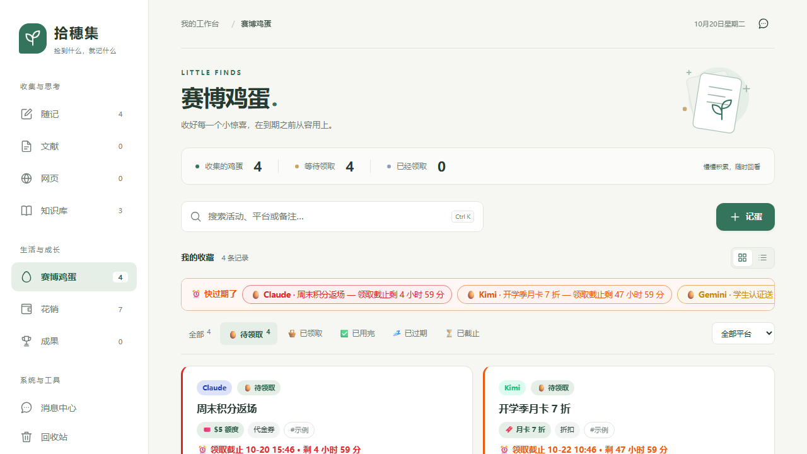
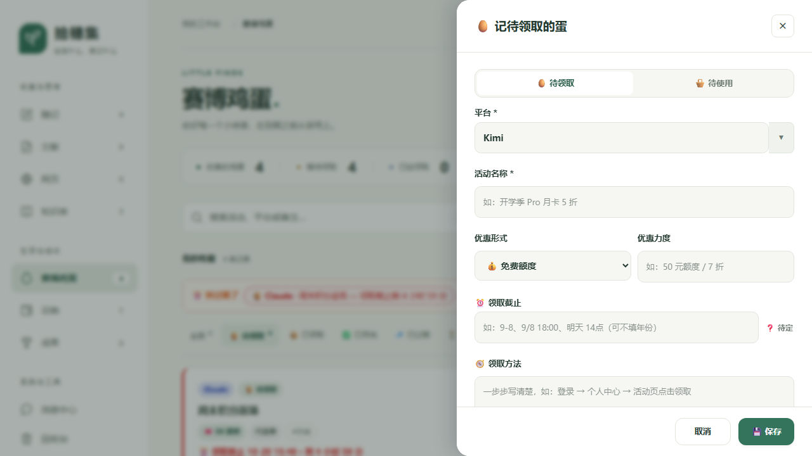
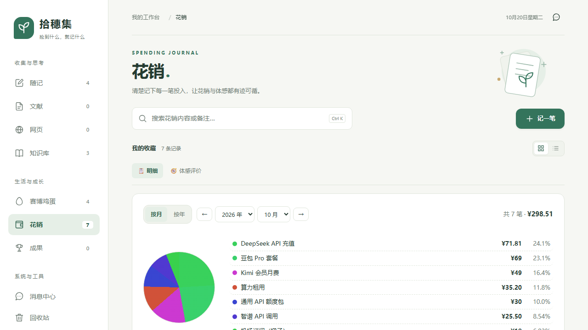

# 🧺 拾穗集 —— 赛博鸡蛋与文献拾穗

捡到什么就记什么。目前有这些板块，以后还能长出新的：

- **📝 随记**：碎片想法随手记；手机端离线也能写、联网自动同步；支持 📌 置顶与贴图（离线加图会先存本机，联网后自动上传）。
- **🥚 赛博鸡蛋**：记录各大模型平台的优惠活动（免费额度、代金券、折扣、试用会员……），按截止日期紧急程度排序展示，页面开着就自动提醒，**不漏领一颗赛博鸡蛋**。
- **📄 文献**：论文待读/已读管理。下载的论文丢进论文文件夹，在这里记一笔就能自动按类别归档，点「📖 阅读」直接用你指定的阅读软件打开，读完自动转入「已读」。
- **🌐 网页**：待读网页（技术文 / 杂项知识都收）的收藏与笔记。记链接就能存，点「🌐 打开」在浏览器打开并**把卡片顶到最前**，读完按类型引导你记下能复用的要点；类型可选内置「技术 / 杂项」，也能自建短词并复用。
- **💰 花销**：学习、办公相关的开销记账（内容 + 金额 + 日期 + 备注，金额最多四位小数）。按月看每一笔，按年按「📦 套餐 / 🔌 API / 🖥️ 算力租用 / 🪜 梯子」归纳，点类别可下钻看明细，列表跟着所选期间走；「🧭 体感评价」还能把记录里写的体感按厂商 / 模型凝练成评价，方便决定下次还买不买。
- **🏆 成果**：做完的事记一笔（时间线 + 类别聚合）。
- **📚 知识库**：从随记 / 文献阅读记录 / 网页笔记三处沉淀知识卡，同名知识可合并；编辑时可点已有标签复用，不用每次重打。
- **🚮 回收站**：各板块删除的记录先进这里保留 30 天；卡片默认展开完整内容，确认后再「恢复」或「彻底删除」。

| 🥚 赛博鸡蛋 | ✍️ 记蛋 | 💰 花销 |
|---|---|---|
|  |  |  |

## 工作台界面

电脑端使用分组侧栏，在「卡片 / 列表」之间切换，布局选择会自动记住。手机端使用底部导航，赛博鸡蛋、花销和成果从「更多」进入。各板块提供搜索与数量概览，电脑和手机统一使用浅色主题。

快捷键：`Ctrl / ⌘ + K` 聚焦搜索，`Alt + N` 新建当前板块的记录，在编辑表单中按 `Ctrl / ⌘ + Enter` 保存。手机端可以记随记，其余板块保留浏览权限。

界面回归：Node.js 18+ 与本机 Edge 下运行 `node tools/test-workspace-ui.mjs`，会自动复制服务与前端到临时目录，并显式隔离文献库和数据。设置 `DANJI_UI_SCREENSHOTS=1` 可在 `output/ui-preview/` 留下演示截图。

## 环境要求

- **Node.js ≥ 18**——没有的话去 [nodejs.org](https://nodejs.org/) 装一个 LTS 版即可。服务端与网页本体只用 Node 标准库，`node server.js` **无需 npm install**；仅「🔗 配对码」二维码出图额外依赖 `qrcode`（见「手动启动」说明）
- Windows（启动脚本/桌面提醒按 Windows 设计；`node server.js` 本体其他平台也能跑）

## 快速开始

双击 **`start.bat`** 或桌面「拾穗集」快捷方式，会弹出一个**图形控制台窗口**：自动在后台启动服务并打开 `http://localhost:8642`。

- 窗口里有状态灯和四个按钮：**🚀 打开网页 / 🔗 配对码 / ▶ 启动服务 / ⏹ 停止服务**，全程没有黑窗口
- **关闭控制台窗口服务照常在后台运行**，网页不受影响；要真正停止请点「⏹ 停止服务」
- 无黑框启动链路：桌面快捷方式 → `launch.vbs` → `control-ui.ps1`（图形窗口）
- 也可以命令行操作：`powershell -File control.ps1 start|stop|status`；桌面快捷方式丢了就跑 `powershell -File make-shortcut.ps1` 重建
- 快捷方式换了图标？右键快捷方式 → 属性 → 更改图标，选 `assets\icon.ico`

手动启动（前台运行，关窗口即停止）：

```
node server.js
```

- 服务端零依赖：只用到 Node.js 标准库，`node server.js` **无需 npm install** 即可跑网页本体
- 仅「🔗 配对码」二维码出图（`tools/pair-qr-png.mjs` / `tools/print-pair-qr.mjs`）依赖 `qrcode`：`tools/qrcode-loader.mjs` 先找仓库根的 `node_modules/qrcode`，找不到再回落 `app/node_modules/qrcode`——在仓库根或 `app/` 目录任一处 `npm install` 都能出码（推荐在仓库根执行）
- **没装 `qrcode` 就真的出不了码**：点「🔗 配对码」会弹「未能生成二维码图片」的提示，终端 ASCII 码走的是同一个依赖、同样出不来，控制台里只剩一段配对 JSON（也会顺手复制到剪贴板）。**App 只有扫码入口、没有手动粘贴框**，这段 JSON 用不上 → 装好 `qrcode` 再出码
- 内存占用约 30MB，可以一直挂着
- 配置：复制 `config.example.json` 为根目录 `config.json`（**已在 .gitignore，不会进仓库**）改端口/监听/论文库路径
- **口令以本机 `config.json` 的 `sync.token` 为准**（该文件不入库）；读取优先级与服务端一致：config 优先、环境变量回落：
  - `DANJI_TOKEN`：局域网访问口令（config 未设 `sync.token` 时的回落）
  - `DANJI_HOST`：监听地址，局域网用 `0.0.0.0`（默认 `127.0.0.1`）
  - `DANJI_PAPERS_DIR`：论文库绝对路径（覆盖 config）
  - `DANJI_TLS_CERT` / `DANJI_TLS_KEY`：HTTPS 证书路径
  - 本地可参考未跟踪的 `local.env.ps1`：`. .\local.env.ps1` 后再 `node server.js`
- 临时覆盖端口：环境变量 `PORT`（如 `set PORT=9000 && node server.js`）

首次打开页面是空的，点「填入示例数据看看效果」可以快速体验。

## 首次使用流程（新机器从零到可用）

1. **装 Node.js ≥ 18**——去 [nodejs.org](https://nodejs.org/) 装一个 LTS 版；服务端只用标准库，装完即用
2. **复制配置**：把 `config.example.json` 复制为根目录 `config.json`（该文件不入库，改的就是本机这份）
3. **按需要改 `config.json` 的字段**（不改就用默认值，也能跑）：
   - `port`：服务端口，默认 `8642`，被占用就换一个
   - `host`：监听地址，默认 `127.0.0.1`（仅本机）；**手机要访问就改成 `0.0.0.0`**
   - `papers_dir`：论文库目录，相对路径相对项目根（如 `papers`），也可以填绝对路径
   - `sync.token`：手机访问口令，留空 = 不校验（只靠监听地址保护）；建议设一个
4. **改完必须重启服务才生效**（配置只在启动时读一次）：双击 `start.bat`，或依次执行 `powershell -File control.ps1 stop`、`powershell -File control.ps1 start`（`start` 不会重启已运行的服务）
5. 浏览器打开 `http://localhost:8642`，确认页面能开、控制台状态灯变绿即完成
6. （可选）手机与电脑同一 Wi-Fi，按「手机使用」章节配对；要离线冷启动再按「HTTPS 证书从哪来」配好证书

## 手机使用（离线优先 + 只读浏览）

### 电脑上怎么启动（推荐）

**方式 A：图形工作台（推荐）**

1. 双击桌面「拾穗集」快捷方式，或项目里的 `start.bat`
2. 控制台会**自动**加载 `local.env.ps1` 里的口令；若存在 `danji-cert.pem` / `danji-key.pem` 则自动 HTTPS
3. 点 **🚀 打开网页（电脑）** → `http://localhost:8642`（或 https）
4. 手机访问地址 = `http(s)://<电脑局域网IP>:8642`（图形控制台不显示这个地址；命令行 `powershell -File control.ps1` 的窗口里有「手机地址」）。用 App 的话直接点控制台的 **🔗 配对码** 扫码即可
5. 手机首次访问填口令（`config.json` 的 `sync.token`）

**方式 B：命令行**

```powershell
powershell -File start-with-env.ps1
# 或已在图形控制台里点「启动服务」即可
```

### 能力边界（请先读这段）

| 场景 | 行为 |
|------|------|
| 手机与电脑**同一 Wi-Fi**，电脑服务已启动 | 可浏览各板块；**仅「随记」可写**（自动同步） |
| **电脑未开机 / 服务未开** | 若已按下方装好 PWA / 装了 App：可打开应用并**离线记随记（含加图片，图片先存手机、联网后自动上传）**；服务恢复后自动同步 |
| 未装 PWA 或未配 HTTPS | 电脑不可达时**打不开页面**（没有本地应用壳） |
| 蛋 / 文献 / 网页 / 花销 / 消息 | 手机端**只读**（不显示编辑/删除/领取等按钮；消息也不标已读） |

> Service Worker 只在**安全上下文**（https 或 localhost）注册（`public/js/pwa.js`）。局域网 `http://IP:端口` 下直接跳过注册并打一条 console.warn，关掉浏览器再打开**无法**离线冷启动；**只有 SW 真的注册上了**（页面底部提示「离线壳已就绪」）再「添加到主屏幕」，才算装好离线壳——见「离线冷启动」一节。

### 日常（同网）

1. 用图形工作台启动服务（见上「方式 A」）
2. 手机与电脑同一 Wi-Fi，用 App 扫控制台的「🔗 配对码」，或用手机浏览器直接打开 `http://<电脑IP>:8642`
3. 顶栏同步胶囊处填写 `config.json` 里的 `sync.token`
4. 电脑本机请用控制台上的本机地址（`localhost` 免口令、完整功能）

### 离线冷启动（电脑关机也能进、也能记）

你要的体验是：**不连电脑也能从零打开并记录，之后同网自动同步**。这在浏览器里必须靠 **PWA 离线壳**，且**不能清理该网站的数据**。

| 操作 | 结果 |
|------|------|
| 关掉浏览器再打开（**不清数据**），从**主屏幕图标**进 | ✅ 可冷启动；能记随记；之后同网自动同步（前提：离线壳已就绪，见下） |
| **清理浏览器 / 清除网站数据** | ❌ 离线壳、缓存、本地待同步队列**全部被删**；电脑不在同一 Wi-Fi 时**进不去** |
| 只是断 Wi-Fi，页面还开着 | ✅ 仍可记（进本地队列），联网后同步 |
| 用 `http://IP`（局域网明文） | ❌ 非安全上下文，Service Worker 根本不注册，关掉后无法冷启动 |

**开通步骤（只做一次）：**

1. 电脑控制台启动服务（根目录有 `danji-cert.pem` / `danji-key.pem` 就走 HTTPS）
2. 手机与电脑同一 Wi-Fi，用 **https** 打开 `https://<电脑IP>:8642`
3. 浏览器菜单 → **添加到主屏幕 / 安装应用**
4. **以后从桌面图标进**，不要每次都重输网址
5. 看页面底部提示（提示语来自 `public/js/perm.js`），照提示处理：
   - 「**离线壳已就绪**」→ Service Worker 已接管，离线壳装好了
   - 「**离线壳未生效：请刷新一次再「添加到主屏幕」**」→ SW 还没接管，刷新一次再添加到主屏幕
   - 「**未配 HTTPS：关掉浏览器后不能冷启动**」→ 当前是局域网明文 HTTP，SW 不会注册

**关于自签证书（重要）：**

- 浏览器报「证书不受信任」是正常的——自签证书没有 CA 背书。点「继续 / 前往」**只是这一次放行，不等于证书变成受信任证书**，也就**不保证** Service Worker 会注册成功、PWA 能离线用。
- 各平台处理不同：桌面 Chrome / Edge 与 Android Chrome 在放行后通常还能继续用；**iOS Safari 不认未受信任证书**，光点「继续」没用，通常要把证书装成描述文件并开启「完全信任」才谈得上 HTTPS 可用（且 PWA 还必须从主屏图标进）。
- 所以别把「点继续」当成功信号，**以页面底部的实际提示 + 断网实测为准**。

**千万不要：** 在浏览器里「清理缓存 / 清除数据 / 清理空间」时勾选该站点——那等于卸载离线 App 并清空未同步随记。

**验证方法：** 断网或关电脑 → 从主屏图标打开 → 应能进「随记」并新增 → 再连上电脑同一 Wi-Fi → 顶栏自动变「已同步 / N 条待同步」。

### HTTPS 证书从哪来

手机 PWA 离线冷启动、以及「添加到主屏幕」，都要求页面走 **https**（局域网 `http://IP` 浏览器不给装离线壳）。证书是一张**自签证书**，自己生成即可，不用买；注意它**默认不被任何设备信任**，手机上第一次访问一定会报证书告警：

1. **生成证书**（在仓库根目录执行，需要本机装了 Git for Windows，自带 openssl）：

   ```
   & "C:\Program Files\Git\usr\bin\openssl.exe" req -x509 -newkey rsa:2048 -nodes -keyout danji-key.pem -out danji-cert.pem -days 825 -subj "/CN=danji" -addext "subjectAltName=IP:192.168.1.100,IP:127.0.0.1,DNS:localhost"
   ```

   把 `IP:192.168.1.100` 换成**电脑当前的局域网 IP**（手机要访问的地址）；有效期 825 天，到期重跑一次即可
2. **证书放在项目根目录**：`danji-cert.pem` + `danji-key.pem`（都已在 `.gitignore`，不会进仓库）
3. **启动服务**：图形控制台点「启动服务」会**自动识别**这两个文件并走 HTTPS，无需额外配置；也可以 `powershell -File start-with-https.ps1`
4. **手机访问**：`https://<电脑IP>:8642` → 浏览器报「证书不受信任」→ 点「继续」只是本次放行，**不等于证书可信**；之后按上一节看页面底部的「离线壳已就绪 / 未生效」提示，再「添加到主屏幕」
5. **电脑 IP 变了要重签**：证书里固化了 IP，IP 变了手机会连不上——重跑第 1 步生成新证书、重启服务即可

> 自签证书的告警是正常的（浏览器不认识你的自签 CA）。点「继续」**不保证** Service Worker 会注册、PWA 能离线；是否真的可用以页面实际提示和断网实测为准（平台差异见上一节）。
>
> **原生 App 壳内不做证书放行**：自签 HTTPS 的电脑在 App 里连不上（`MainActivity.java` 没有放行自签证书的逻辑）。所以 App 配对要走明文 HTTP，办法见「原生 App」一节——**没有「HTTP/HTTPS 模式」切换按钮**，控制台会自动探测证书，手动启动则由 TLS 环境变量决定。

### 原生 App（Android APK，推荐替代 PWA）

浏览器 PWA 有硬伤：清浏览器数据就丢离线壳和未同步记录。原生 App（Capacitor 壳）没有这个问题：

| 场景 | PWA（浏览器） | 原生 App |
|------|--------------|----------|
| 清除**手机浏览器**数据 | ❌ 离线壳 + 未同步随记全丢 | ✅ 不受影响 |
| 不与电脑同 Wi-Fi 时冷启动 | ❌ 打不开（除非已装离线壳且不清数据） | ✅ 能进、能记随记 |
| 局域网 HTTP 直接可用 | ❌ SW 不注册，需 https（自签还要额外处理证书信任） | ✅ HTTP + 私网门禁 |

**安装与配对（只做一次）：**

1. 电脑上打包：`powershell -ExecutionPolicy Bypass -File app\build-apk.ps1`（正式签名包加 `-Release`，见 `app/README.md`），或从 GitHub Actions 下载 APK
2. APK 发到手机安装（允许未知来源）
3. 电脑控制台点 **🔗 配对码** → 手机 App 里「开始扫码」对准窗口里的二维码 → 提示「配对成功」；配对一次即可，之后同 Wi-Fi 自动同步。**App 只有扫码这一条入口**（没有手动输入 / 粘贴框）；二维码出图需要 `qrcode` 包（仓库根或 `app/` 目录 `npm install` 都行），没装就出不了码
4. **二维码协议必须与实际服务一致**。原生 App 不接受自签 HTTPS；需要 HTTP 时，先在控制台停止服务（手动运行的服务在原终端按 Ctrl+C 停止），关闭旧控制台。保管好证书，不要删除。若已启用自签 HTTPS，推荐在项目目录另开一个新的 PowerShell 窗口，用下面命令启动 HTTP：

   ```powershell
   # 只清除此进程继承的 TLS 环境变量，不改本地配置或证书文件。
   Remove-Item Env:DANJI_TLS_CERT, Env:DANJI_TLS_KEY -ErrorAction SilentlyContinue
   node server.js
   ```

   该窗口须保持运行；看到启动日志为 HTTP 后，再用新开的 PowerShell 生成与服务一致的二维码：

   ```powershell
   . .\lib.ps1
   Remove-Item Env:DANJI_TLS_CERT, Env:DANJI_TLS_KEY -ErrorAction SilentlyContinue
   $pairBase = 'http://{0}:{1}' -f (Get-LanIPv4), (Get-AppConfig).port
   # 明确使用 HTTP 出码；口令只在本机读取，请勿分享二维码。
   node tools/print-pair-qr.mjs --base $pairBase --token (Get-EffectiveToken)
   ```

   先在手机浏览器访问二维码中的 HTTP 地址，确认能连接，再在 App 扫终端二维码。这个过程不使用控制台自动出码，因为它会探测根目录证书。之后仍须保持服务使用 HTTP；若重新用控制台启动且根目录有证书，服务会恢复 HTTPS，App 保存的 HTTP 配对随即失效。不要把“临时改协议配一次”当作持续可同步方案。没有证书、未设置 TLS 环境变量时，可直接使用图形控制台启动和出码。
5. 监听地址与口令以本机 `config.json` 为准（`host` + `sync.token`）：**新克隆的默认配置是 `host: 127.0.0.1`（只监听本机回环，手机连不上）且 `sync.token` 为空（不校验口令）**。只有你在本机 `config.json` 里把 `host` 改成 `0.0.0.0`（或设 `DANJI_HOST=0.0.0.0`）**并且**设了 `sync.token`，才谈得上「局域网可达且带口令保护」；改完**必须重启服务**（配置只在启动时读一次）。本机回环访问永远免口令（`server.js` 按来源 IP 判定电脑端 / 手机端）
6. **电脑 IP 变化后必须在控制台重新出码再扫**（旧二维码里固化了旧 IP，扫旧码必 timeout）

**边界：**

- HTTP 明文只允许连**局域网私网地址**（192.168.x.x / 10.x.x.x / 172.16-31.x 等）；公网地址必须 https
- 电脑若开了自签 HTTPS，App 连不上（壳内不做证书放行，`MainActivity.java` 没有放行自签证书的逻辑）——配对要走明文 HTTP，办法见上面第 4 步（先停服务，在新进程明确启动 HTTP 并按相同协议出码）；项目里**没有**协议切换按钮
- 卸载 App / 清 App 数据仍会丢未同步记录——回到同一 Wi-Fi 让顶栏变「已同步」后再卸载，日常保持定期同网即可
- 服务端升级 API 后，旧 APK 顶栏会提示「App 需升级」，重打安装新 APK 即可（数据保留）

### 配置与隐私

- 公开仓库只保留 `config.example.json`；本机 `config.json`、`local.env.ps1`、`*.pem` 均在 `.gitignore`
- 口令写在本机 `config.json` 的 `sync.token`（已在 .gitignore，不入库）；环境变量 `DANJI_TOKEN` 可作回落，config 优先
- 校园网若隔离设备，手机可能无法访问电脑 IP；可改用手机热点让电脑连入后再试
- 原生 App 壳内页面源是 `https://localhost`，`` 直连 `http://局域网IP` 会被 WebView 混合内容策略拦下；因此贴图统一走 `public/js/img-urls.js`：原生壳直连 CapacitorHttp 插件（`responseType:'blob'`，base64 回传解码成 Blob），Web 端走普通 fetch，最后转 objectURL 给 ``——与同步/上传同一条已验证的 HTTP 通道。`app/capacitor.config.json` 的 `android.allowMixedContent` 也开着作保险

## 日常使用

| 想做什么 | 怎么做 |
|---|---|
| 记录一个活动 | 右上角「＋ 记蛋」，填平台、名称、截止时间、领取方法 |
| 看什么最紧急 | 顶部「⏰ 快过期了」横幅 + 卡片左侧颜色条（红 ≤24h / 橙 ≤3天 / 黄 ≤7天）；点横幅条目会跳到它所属的分类（待领取 / 已领取）并高亮闪一下 |
| 领到了 | 卡片上点「🧺 已领取」；用完了点「🏁 用完了」 |
| 去活动页 | 填了链接的卡片有主按钮：待领取「🚀 去领取」、已领取「🔍 查用量」，点一下直达 |
| 过了领取截止 | 填了明确截止时间的蛋，一过点会自动转入「已截止」并记一条消息；所有待领取的蛋卡片上都常驻「⏳ 已截止」，没到期也能随时手动结掉（误判可点卡片上的「✅ 其实领到了」改回） |
| 看过期消息 | 赛博鸡蛋顶栏「💬 消息」（在 🔔 通知开关左边）：未读时按钮上有红点数字，点开消息即已读变灰，可单条删 / 全部已读 / 清空已读；点「→ 查看原蛋」跳到对应分类并高亮 |
| 紧急随记置顶 | 随记卡片上点「📌 置顶」（桌面悬停卡片出按钮，手机常显）：置顶条目排到列表最前并带 📌 标记与描边；多条置顶时按「最近动作」排——**刚编辑过的置顶随记会浮到置顶组最前**，没编辑过的按置顶时间；再点「📌 取消置顶」还原。手机上置顶/编辑离线也能操作，联网后自动同步到电脑 |

### 桌面提醒

右上角 🔔 是一个**真开关**：首次点击授予通知权限并开启；之后再点一下就关闭（图标变 🔕 变暗），再点一下重新开启。开关状态存在浏览器里，刷新不丢。

开启状态下，只要页面开着，**领取截止前 24 小时内**（已领取的蛋：使用截止前 24 小时内）会弹系统通知；点击通知会自动跳到该蛋所在的分类标签页（待领取 / 已领取 / 已过期）并高亮。同一颗蛋只提醒一次（刷新页面也不会重复弹）。已领取的蛋一旦过了使用截止，会自动转入「已过期」；填了明确领取截止的待领取蛋一过点也会自动转入「已截止」。这两种自动流转除了弹系统通知，**还会各记一条到赛博鸡蛋顶栏「💬 消息」板块**，不怕通知一闪而过漏掉。想改提醒提前量，编辑 `public/config.js` 里的 `remind.hours`。

### 字段说明

- **领取截止**：什么时候之前要领（决定紧急程度排序和横幅提醒；填了明确时间、一过点就自动转入「已截止」并弹提示）
- **使用截止**：领到之后什么时候之前要用（「已领取」状态下会继续跟踪；过了就自动转入「已过期」并弹提示）
- **状态**：待领取 → 已领取 → 已用完；过了领取截止标「已截止」，过了使用截止标「已过期」
- **自由填写**：截止时间支持 `9-8`、`9/8 18:00`、`明天 14点` 等写法，不填年份默认今年；不知道就填「待定」，卡片会显示「待确认 ❓」并进横幅提醒（「待定」或没填的不会自动流转，但卡片上「⏳ 已截止」随时可手动结掉）
- **分模式记录**：记蛋面板分「🥚 待领取 / 🧺 待使用」，只显示相关字段，不臃肿

## 📄 文献板块

论文库根目录：优先环境变量 `DANJI_PAPERS_DIR`，否则读本地 `config.json` 的 `papers_dir`（相对路径相对项目根；公开仓库请用 `config.example.json` 复制一份本地 config，不要提交自己的路径）。改完重启服务生效。**本机文献库目录是固定约定，禁止改动——详见仓库根 `AGENTS.md` 第 1 条。** 首次使用自动创建：

```
papers\
├── （下载的论文先随手丢这里）
├── 待读\
│   └── 类别子文件夹\（如 待读\深度学习\xxx.pdf）
└── 已读\
    └── 类别子文件夹\
```

| 想做什么 | 怎么做 |
|---|---|
| 记一篇论文 | 「＋ 记论文」，标题**输入一部分就行**，会自动模糊匹配论文文件夹里的文件（高置信自动选中，多命中给候选列表） |
| 分类 | 「类别」可从已有类别选，也可直接输入新类别——保存时自动在待读/已读下建文件夹并归档 |
| 阅读 | 卡片上点「📖 阅读」，用该论文指定的阅读软件打开（没指定就用系统默认方式） |
| 排序 | 列表按**最近阅读时间**倒序：点「📖 阅读」的论文会**立刻升到列表顶部**（卡片短暂高亮 + 提示），卡片上显示「🕘 最近阅读」；没读过的按添加时间排；笔记里手填的「读完日期」也参与排序，所以补记一篇很久前读的论文不会莫名置顶 |
| 读完 | 点「✅ 读完了」，文件自动从 待读/类别 移到 已读/类别；点错了「↩️ 移回待读」搬回去 |
| 读完记一笔 | 点「✅ 读完了」会弹出「📝 阅读记录」抽屉：**写满三行速记（核心问题 / 核心做法 / 核心发现）并保存后，才会归档到「已读」**。没写满直接关掉，这篇还留在「待读」，已填内容会自动存成草稿，下次点「读完了」自动带回来。抽屉里其余字段（课题关系、能借鉴什么、可引用观点、下一步、最有用的部分、存疑局限、表达与摘抄）都不强制 |
| 重读再记 | 一篇论文可以记**多条**记录：卡片上点「📝 记录 N」→「＋ 再记一条」，形成阅读日志（按读完日期倒序）。已读后的补记只要写点东西就能存，不受三行门槛限制 |
| 把笔记用起来 | 搜索框能搜到笔记全文；筛选栏「笔记：已记 / 未记」一眼找出读过还没记的；已读卡片直接显示最新一条摘要 + 关联度徽章 |
| 换类别 | 编辑里改类别，文件自动搬到新类别文件夹 |
| 删除 | 只删记录，磁盘上的文件保持原位 |

阅读软件路径示例：`C:\Program Files\SumatraPDF\SumatraPDF.exe`，留空 = 系统默认打开方式；会记住上次填写的路径。

## 🌐 网页（待读网页 + 笔记）

看到值得读的链接就丢进来，读完按类型引导记笔记，以后靠搜索和「用得上吗」翻回来复用。

| 想做什么 | 怎么做 |
|---|---|
| 记一个网页 | 顶栏切到「🌐 网页」→「＋ 记网页」：粘贴链接（写 `example.com` 也会自动补 `https://`），标题可以留空——离开链接框会自动抓网页 `<title>`，也可以点「🔄 自动取标题」 |
| 分类型 | 记的时候选「🔧 技术」或「🧩 杂项」，它决定读完后引导你填哪套字段（之后还能改）；也可以直接输入自建短词（如「工具」），用过一次后会出现在下拉和筛选栏里。输入框显示中文类型名，内部仍存 `tech` / `misc`，两者不会混淆 |
| 打开 | 卡片上点「🌐 打开」在原站新标签页阅读，并把这张卡**顶到列表最前**（卡片上显示「🕘 最近阅读」）；装了下方扩展后，原页滚动进度自动回传，卡片显示进度徽章「读到 NN% / ✔ 已读完」，下次打开同链接自动恢复 |
| 读完记笔记 | 点「✅ 读完了」→ 抽屉里**先选类型**再填：<br>🔧 **技术**：必须写满「🧠 一句话 + 🔧 关键做法 + 📈 结论」才归档到「已读」；另有 💻 工具/库、⚠️ 坑与局限<br>🧩 **杂项**：写一句「🧠 它讲了什么」就能归档；另有 ✅ 关键事实、🗓 什么时候会用到、🔍 来源可信度<br>两类共用：⚡ 用得上吗（立刻能用 / 以后可能用 / 长见识）、📖 值得原样记下的一句、🧭 还想顺着查什么 |
| 没写满就关掉 | 和文献一样：留在「待读」，已填内容存成草稿，下次点「读完了」自动带回来 |
| 重读再记 | 一个网页可以记**多条**笔记（按读完日期倒序），卡片上露最新一条的摘要 + 「用得上吗」徽章 |
| 找回来 | 搜索框能搜到标题、域名、链接、标签、备注和**所有笔记全文**；筛选支持 类型 / 用得上（⚡立刻能用就是行动清单）/ 未记笔记 |

排序规则与文献一致：按最近阅读时间倒序，没读过的按添加时间排。

### 原页阅读进度（浏览器扩展，可选）

想在**原版网页**上阅读也保留进度（站内不做阅读代理），装 `extension/` 目录里的扩展（仅电脑浏览器，手机端不做阅读功能）：

1. Edge 打开 `edge://extensions`（Chrome 为 `chrome://extensions`）→ 开启「开发人员模式」→「加载解压缩的扩展」→ 选仓库里的 `extension/` 目录
2. 点工具栏扩展图标 → 填电脑端地址（本机阅读填 `http://localhost:8642`）与口令（`config.json` 的 `sync.token`）→ 保存 →「测试连接」应显示连通
3. 之后直接用浏览器打开拾穗集「网页」板块记过的链接：滚动进度自动回传（卡片进度徽章同步更新），下次打开同一链接自动恢复到上次位置并提示「已回到〈章节标题〉」

原理：扩展在顶层文档注入内容脚本，记录滚动比例 + **视口顶部锚点**（最近的标题，没有标题就取顶部文本块片段）；后台按 URL 匹配 `网页` 板块记录后写 `read_progress` / `read_anchor`。恢复时先等页面高度稳定（JS 渲染站的高度是逐步长出来的），优先按锚点定位——页面高度怎么变都不漂移，找不到锚点才按比例回退；恢复完 1~3 秒内还会按锚点再校正两次。不碰页面内容、不改原页体验。未配置或电脑没开时静默不工作。

**使用注意：**

- 扩展只在**拾穗集「网页」板块记过的链接**上生效（按 URL 匹配记录写进度）；未配置或电脑没开时静默不工作
- **popup 两格别填反**：地址 = `http://localhost:8642` 这种访问地址；口令 = `config.json` 里 `sync.token` 那串。「测试连接」直接用表单当前值测（不必先点保存），测通自动保存

## 💰 花销（按条目记账 + 两级饼图）

学习、办公相关的开销随手记一笔，按月 / 按年看清钱花在哪。每笔带一个**类别（📦 套餐 / 🔌 API / 🖥️ 算力租用 / 🪜 梯子）**，只用于归纳展示——年视图先按类别汇总，点一下再钻进这一类看每一笔。

| 想做什么 | 怎么做 |
|---|---|
| 记一笔 | 顶栏切到「💰 花销」→「＋ 记一笔」：填**花销内容**和**金额**就能存；日期默认今天，备注随便写一句 |
| 类别怎么定 | 抽屉里点「📦 套餐 / 🔌 API / 🖥️ 算力租用 / 🪜 梯子」；没点的话按标题自动猜：含 `梯子`/`机场`/`vpn`/`代理`/`节点`/`clash` 等 → 梯子（**梯子优先**，机场订阅不会被「订阅」抢走），含 `api`/`接口` → API，含 `算力`/`租用`/`gpu` → 算力租用，含 `token`/`资源包`/`套餐`/`会员`/`pro`/`额度` 等 → 套餐，都没命中 → 套餐。你点过之后就不再被自动改 |
| 金额怎么写 | `1280`、`1280.5`、`¥1,280`、`1,280.50`、`0.1234` 都行（自动去符号和千分位）；**非整数最多四位小数**，只支持正数，写错会就地提示 |
| 按月看 | 统计卡切「按月」+ 选年月（或 ← → 翻月）：**饼图每个扇区 = 一笔花销**，右侧图例按金额从大到小列出「内容 · 金额 · 占比」；按月不按类别看，所以从「按年」下钻的状态切过来会自动清掉类别筛选 |
| 按年看 | 切「按年」+ 选年份：饼图先按类别归纳成 **📦 套餐 / 🔌 API / 🖥️ 算力租用 / 🪜 梯子 四个扇区**（有金额才显示）；**点扇区或图例那一行**就钻进去，饼图改成显示这一类里**同名合并后**的占比（这一年在这个名目上花了多少，图例带 `×N` 表示由几笔合成），下方列表同时只留这一类，右上角出现「正在看 📦 套餐 ✕」，再点一次或点 ✕ 回到总览 |
| 看明细 | 列表跟着所选期间（+ 类别）走，右上角显示「共 N 笔 · ¥X」；按日期倒序，同一天按录入时间倒序 |
| 找一笔 | 顶栏搜索框搜内容 / 备注，只在当前期间（和已选类别）内过滤 |
| 改 / 删 | 卡片上「✏️ 编辑」「🗑」（删除有确认）；卡片上有类别小徽章 |

饼图细节：类别层用 `config.js` 里定义的固定色相（套餐蓝、API 橙、算力紫、梯子青）；逐笔层按名字稳定取色（同名同色，月视图按记录 id），年视图下钻时同名记录合并成一个扇区、一行图例（行尾 `×N` 是合进来的笔数），明细列表里每笔照旧可见；一个期间超过 24 个扇区时，最小的若干笔会合并成一个「其余 N 笔」扇区（金额与占比仍准确），阈值是 `config.js` 里的 `expenses.maxSlices`。图例最多占 260px 高，条目多了在里面**上下滚动**，不会出现左右拖动条。

> 老数据不用管：启动时会给没有类别的旧记录按同一套关键词规则补一个类别，只写一次盘，不会覆盖你手动改过的值；金额精度放宽到四位小数后，旧的两位小数记录照原样显示。

## 🚮 回收站（删了还能反悔）

电脑端侧栏「回收站」：各板块（随记 / 赛博鸡蛋 / 花销 / 成果 / 知识库 / 网页 / 文献）删除记录时不再直接抹掉，而是先放进回收站**保留 30 天**。

- 卡片**默认展开完整内容**：标题、正文、备注、标签、金额、类别、阅读日志、随记贴图缩略图等都会原样展示，不用猜「删掉的到底是什么」。
- 每条可以「↩︎ 恢复」回原板块（保留原创建/更新时间），或「彻底删除」；右上角「清空回收站」一次清空（都有二次确认，不可反悔）。
- 随记的图片文件在进回收站时**不删**，彻底删除 / 到期清理时才删；到期项在服务启动或下次写回收站时自动清掉。
- 回收站只在电脑端出现，不参与手机同步。

### 🧭 体感评价（从记录里凝练各家的使用体感）

花销板块顶部「📋 明细 / 🧭 体感评价」页签切换。评价视图看的是**全部历史**，把每笔花销的标题 + 备注认领到「主体」（DeepSeek、通义 Qwen、Kimi、Claude、LongCat、AutoDL 算力等，词表在 `config.js` 的 `expenses.subjects`，想收录新厂商就添一条关键词），按主体凝练出：

| 区块 | 内容 |
|---|---|
| 素材（自动） | 累计花费 · 笔数 · 类别拆分徽章 · 最近一笔日期，以及「📎 记录里的原话」：从备注里切出与这家相关的句子，按 💰价格 / 🧭决策 / 🧠体验 打标（词表 `expenses.insightTags`），每条注明来自哪笔花销 |
| 结论（你来写） | ⭐ 1-5 体感评分、「后续打算」快捷选项（➕ 继续 / ➖ 减少 / ⏸ 观望 / ⛔ 停掉）、一段总评文字——没有头绪时点「✨ 依记录生成草稿」，会把合计与要点摘录填进框里，改成自己的话再「💾 保存」即可；「🧹 清除」随时回到纯记录视角 |

评价按主体存进 `data/insights.json`，改评价不影响花销记录本身；备注太短没提到任何主体的花销不会出现在评价里，页面底部会提示哪几笔没被认领，照着去 `config.js` 加关键词就能收编。

## 数据与备份

所有数据存在 `data/` 下的纯文本 JSON，每个板块一个文件：`eggs.json`（赛博鸡蛋）、`papers.json`（文献）、`sites.json`（网页）、`expenses.json`（花销）、`insights.json`（体感评价）、`messages.json`（消息）、`ideas.json`（随记）、`achievements.json`（成果）、`kb.json`（知识库）、`trash.json`（回收站，各板块删除记录保留 30 天）；随记贴图原图在 `data/images/`。均可直接查看编辑：

- **先停服务再动手**：备份、恢复、手改 JSON 之前，先点控制台的「⏹ 停止服务」（或 `powershell -File control.ps1 stop`）。服务启动时把整个 JSON 读进内存，每次保存都是**整份重写**（临时文件 + 改名），所以服务开着的时候改文件会被内存里的旧数据覆盖回去
- **备份**：停服务后把整个 `data/` 目录复制走（各板块 JSON + `images/` 贴图原图，整个目录复制，别只挑 JSON）
- **恢复**：在停服务状态下把备份的 `data/` **完整**还原回项目根目录（含 `images/`），确认文件齐了再启动服务
- **迁移**：项目目录和 `data/` 一起拷走即可；但**文献库不在 `data/` 里**——论文原文件放在 `config.json` 的 `papers_dir` 指向的目录（可能在项目外），要**单独备份**。迁移到新机器时，除了拷项目目录，还要把文献目录拷过去，并核对新机器 `config.json` 的 `papers_dir`（或 `DANJI_PAPERS_DIR`）——**只复制项目文件夹带不走外置文献库**
- 列表排序用的 `last_read_at`（论文 = 最近一次点「📖 阅读」、网页 = 最近一次点「🌐 打开」的时间）就存在对应 JSON 里，可手动清空，清空后该条回落到按添加时间排
- 写入采用「临时文件 + 重命名」，断电/崩溃不会写坏数据

## 想扩展功能？

架构就是为扩展准备的：

1. **改常量**（平台列表、优惠类型、提醒规则、网页笔记的字段词表、花销类别与饼图扇区上限）→ `public/config.js`（网页的两套引导字段在 `siteNote.fields`，归档门槛在 `siteNote.gate`；花销在 `expenses`，其中类别 id / 关键词要和 `server.js` 的 `EXPENSE_CATEGORIES` 同步）
2. **改界面/加视图** → `public/js/`（Vue 3 组件，原生 ES module，无需构建）+ `public/style.css`
3. **加接口** → `server.js` 里的 `route()` 表，加一行就是一个新端点
4. **数据字段变更** → `server.js` 里的 `normalizeActivity()` / `normalizePaper()` / `normalizeSite()` / `normalizeExpense()` 和 `migrate()`（配合 `schema_version` 做平滑迁移）

一些顺理成章的扩展方向：统计面板（这个月白嫖了多少钱）、同局域网手机访问（默认只监听本机 `127.0.0.1`，设环境变量 `DANJI_HOST=0.0.0.0` 后重启即可——局域网访问需填口令 `DANJI_TOKEN`（见「配置与隐私」），仍建议仅在可信网络开放）、接入通知机器人、定时抓取活动页。

## 常见问题

| 现象 | 处理 |
|---|---|
| 提示「端口被占用」/ 打不开 8642 | 拾穗集可能已经在运行了，直接访问 `http://localhost:8642`；确实要换端口就改 `config.json` 的 `"port"`（控制台会跟着变），或临时设环境变量 `PORT` |
| 双击脚本报「无法加载文件……执行策略」 | 管理员 PowerShell 跑一次 `Set-ExecutionPolicy -Scope CurrentUser RemoteSigned`；或者直接 `node server.js` |
| 页面显示「无法连接拾穗集服务」 | 后台服务没在运行：双击 `start.bat` 启动，然后点页面上的「重试」 |
| 记了内容保存没反应 | 看按钮：显示「⏳ 保存中…」是在等网络；弹出「无法连接服务」说明服务停了，重启服务后再保存，已填内容不会丢 |

## 开机自启（可选）

`Win + R` 输入 `shell:startup`，把**桌面「拾穗集」快捷方式**复制进去即可（或对 `launch.vbs` 右键 → 发送到 → 桌面快捷方式，把生成的快捷方式放进去）。

开机后的实际行为：`launch.vbs` → `control-ui.ps1` → **会弹出图形控制台窗口**（没有黑框，但有窗口），并且在服务没起来时会**自动启动服务并打开浏览器页面**。项目**没有**静默自启模式；不想被打扰就开机后把控制台窗口关掉（后台服务照常运行），或者干脆不放自启。

## 卸载与清理

1. **停服务**：图形控制台点「⏹ 停止服务」，或命令行 `powershell -File control.ps1 stop`；前台运行的话直接关窗口。确认状态灯变灰 / `control.ps1 status` 显示 stopped
2. **撤销开机自启**：`Win + R` 输入 `shell:startup`，删除里面的「拾穗集」快捷方式
3. **撤销桌面快捷方式**：删除桌面的「拾穗集」快捷方式（`make-shortcut.ps1` 生成的那个；想重建再跑一次该脚本）
4. **删数据**：删除项目根目录的 `data/` 文件夹（各板块 JSON + 随记贴图原图）——**删了不可恢复**，先按「数据与备份」复制一份
5. **删本地配置（可选）**：`config.json`、`local.env.ps1`、`danji-cert.pem` / `danji-key.pem` 都是本机私密文件，不需要了可直接删
6. **卸载可选组件**：浏览器扩展去 `edge://extensions` 移除；原生 App 在手机上卸载即可（卸载前先联网同步，避免丢未同步随记）

## 技术栈

Node.js 标准库（http 服务 + JSON 存储）+ Vue 3（本地文件，无构建步骤）+ 手写 CSS。前端 `public/` 约 1.1 万行（不含 vendor 里的 Vue / 扫码库）、后端 `server.js` 约 2300 行，全部代码人类可读，适合随手改。

### 同步回归验证

- `npm test`：同步判定、回报队列、电脑收件箱、服务启动及报告去重。
- `npm run test:sync:flow`：用 Edge 和真实 IndexedDB 验证在线同步、离线热启动/冷启动、旧账本恢复、上传冲突与服务重启。原生桥由持久化测试桩模拟。
- `npm run test:sync:native`：用本机 JDK 验证 APK 快照写入器，覆盖 UTF-8 内容、写入失败、替换失败及旧快照保留。可用 `JAVA_HOME` 指定 JDK。
- `npm run test:ui`：验证电脑与手机布局、表单键盘操作及离线随记保存。

所有服务测试使用临时副本、独立 `data/` 和显式临时 `DANJI_PAPERS_DIR`。浏览器测试需要本机 Edge，可用 `EDGE_PATH` 指定。

手机诊断可运行 `adb logcat -v time -s DanjiSync chromium`，对照原生 `cycle=… stage=snapshot-saved`、JS `[danji-snap] applied` 和 `[danji-sync]` 阶段记录；相同数据用 `boot` 与版本号对应。消息保留 `sync_source`、`sync_cycle`、`sync_stage` 等诊断字段。日志不记录内容正文和配对口令。

失败回报只尝试即时发送，网络恢复后不补发旧失败；成功回报保留重试。断网告警仍保存在手机本地消息中。升级旧 APK 后先联网同步一次，可修复旧版本留下的空 `boot_id` 账本。服务端重启导致进程标识变化时，暂不跨进程导入快照，需联网同步建立新基线，避免旧快照覆盖新数据。

## License

[MIT](LICENSE)
